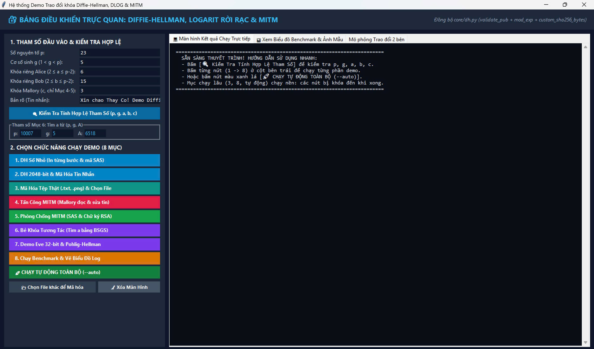
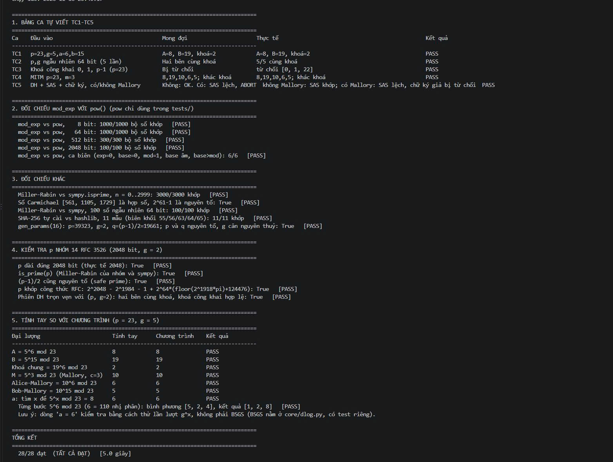

# 🔐 Bài tập nhóm: Trao đổi khóa Diffie–Hellman - bài toán logarit rời rạc (DLOG) kèm minh họa tấn công người đứng giữa (MITM) và cách phòng chống. 


-16a34a?style=for-the-badge&logo=pytest&logoColor=white)


## 📖 Giới thiệu & Mục tiêu dự án

Dự án xây dựng một hệ thống mô phỏng trực quan, toàn diện giao thức trao đổi khóa **Diffie–Hellman** bằng ngôn ngữ Python thuần (không phụ thuộc thư viện mật mã bên ngoài cho tầng lõi). Hệ thống phục vụ nghiên cứu học thuật và thực nghiệm an toàn thông tin, giúp minh họa rõ:

* Bản chất toán học của quá trình thiết lập khóa bí mật chung qua kênh truyền công khai không an toàn.
* Cách ứng dụng khóa chung vào mã hóa dòng cho dữ liệu văn bản và tệp nhị phân thực tế.
* Kịch bản tấn công nghe lén, sửa đổi gói tin **Man-in-the-Middle (MITM)** và các cơ chế phòng chống bằng mã xác thực ngắn **SAS (SHA-256)** kết hợp **Chữ ký số RSA**.
* Giới hạn an toàn của tham số kích thước nhỏ trước các thuật toán thám mã **Logarit rời rạc (DLOG)** như Vét cạn, Baby-Step Giant-Step (BSGS) và Pohlig–Hellman.

---

## ✨ Tính năng chính

| Chức năng | Mô tả |
| :--- | :--- |
| **Trao đổi khóa DH (Số nhỏ & RFC 3526)** | Minh họa từng bước thuật toán bình phương và nhân với số nhỏ, đồng thời hỗ trợ tham số an toàn chuẩn **RFC 3526 Group 14 (2048-bit)** kèm mã xác thực ngắn **SAS**. |
| **Mã hóa & Giải mã Dữ liệu thật** | Sinh dòng khóa giả ngẫu nhiên từ khóa chung K để mã hóa/giải mã tin nhắn văn bản (`.txt`) và hình ảnh nhị phân (`.png`) qua phép toán XOR, đảm bảo toàn vẹn 100%. |
| **Mô phỏng Tấn công & Phòng chống MITM** | Tái hiện kịch bản kẻ trung gian (Mallory) chặn nghe lén và sửa đổi gói tin trên đường truyền; triển khai cơ chế đối chiếu mã **SAS (SHA-256 tự cài đặt)** và **Chữ ký số RSA** để phát hiện giả mạo. |
| **Phá mã DLOG & Biểu đồ Benchmark** | So sánh hiệu năng giữa Vét cạn, **Baby-Step Giant-Step (BSGS)** và **Pohlig–Hellman**; tự động đo thời gian thực thi và xuất biểu đồ độ phức tạp. |
| **Giao diện Trực quan (GUI & CLI)** | Hỗ trợ cả giao diện dòng lệnh ([app/cli.py](app/cli.py)) và giao diện đồ họa **Tkinter** đa thẻ ([app/gui.py](app/gui.py)), tích hợp bảng kiểm tra tham số và không gian mô phỏng tương tác 2 bên **Alice – Bob**. |
| **Kiểm thử Tự động (`pytest`)** | Bộ 28 ca kiểm thử chức năng, đối chiếu thư viện chuẩn (`pow`, `sympy`, `hashlib`), đối chiếu tính tay và kiểm thử điều kiện biên tự động. |

---

## 🛠️ Công nghệ & Môi trường yêu cầu

* **Ngôn ngữ:** Python 3.10 trở lên (hỗ trợ xử lý số nguyên lớn tự nhiên cho khóa 2048-bit).
* **Tầng thuật toán lõi:** Cài đặt thuần bằng Python chuẩn (tự viết `mod_exp`, Miller–Rabin, SHA-256, RSA, BSGS, Pohlig–Hellman).
* **Giao diện đồ họa:** `tkinter` / `ttk` (thư viện chuẩn Python) kết hợp `threading` & `queue` xử lý đa luồng bất đồng bộ.
* **Trực quan hóa biểu đồ:** `matplotlib >= 3.7.0`.
* **Kiểm thử & Đối chiếu toán học:** `pytest >= 7.0.0`, `sympy >= 1.12`.

---

## 🚀 Hướng dẫn cài đặt & Chạy chương trình

### 1. Tải mã nguồn và cài đặt thư viện
```bash
git clone https://github.com/nguyenanhtho200107-pixel/DH_key_exchange.git
cd DH_key_exchange
pip install -r tests/requirements.txt
```

### 2. Khởi chạy ứng dụng
* **Chạy giao diện đồ họa (Khuyên dùng):**
  ```bash
  python -m app.gui
  ```
* **Chạy giao diện dòng lệnh (CLI):**
  ```bash
  python -m app.cli
  # Hoặc chạy tự động toàn bộ 8 kịch bản demo với dữ liệu mẫu mặc định:
  python -m app.cli --auto
  ```

### 3. Chạy kiểm thử tự động
* **Chạy toàn bộ bộ kiểm thử đơn vị với Pytest:**
  ```bash
  pytest -v
  ```
* **Xuất báo cáo đối chiếu 28 ca kiểm thử:**
  ```bash
  python -m tests.run_report
  ```

---

## 🖼️ Minh họa giao diện & Kết quả thực nghiệm

### Giao diện điều khiển trực quan (GUI)


### Kết quả kiểm thử tự động (28/28 ca đạt)


---

## 📁 Cấu trúc dự án & Thứ tự phụ thuộc

Hệ thống được thiết kế theo kiến trúc phân tầng sạch, đảm bảo nguyên tắc một chiều (`app/` và `tests/` gọi `core/`, tầng `core/` hoàn toàn độc lập):
```text
DH_key_exchange/
├── .github/
│   └── CODEOWNERS            # Phân quyền quản lý mã nguồn theo từng thành viên
├── core/                     # Tầng thuật toán lõi (Không phụ thuộc giao diện)
│   ├── __init__.py           # Khởi tạo gói core
│   ├── dh.py                 # Nguyên thủy toán học, DH RFC 3526, SHA-256, SAS & MITM
│   ├── dlog.py               # Thuật toán giải Logarit rời rạc (Vét cạn, BSGS, Pohlig-Hellman)
│   └── stream.py             # Bộ sinh dòng khóa LCG & mã hóa/giải mã dòng XOR
├── app/                      # Tầng ứng dụng & Giao diện người dùng
│   ├── __init__.py           # Khởi tạo gói app
│   ├── gui.py                # Giao diện đồ họa Tkinter 3 thẻ & đa luồng bất đồng bộ
│   ├── cli.py                # Giao diện dòng lệnh tương tác 8 chức năng & chế độ --auto
│   ├── filecrypt.py          # Xử lý mã hóa/giải mã tệp tin thực tế (.txt, .png)
│   └── benchmark.py          # Đo hiệu năng BSGS & vẽ biểu đồ log bằng Matplotlib
├── tests/                    # Tầng kiểm thử tự động (Pytest & đối chiếu chuẩn)
│   ├── README.md             # Hướng dẫn chạy kiểm thử chi tiết
│   ├── conftest.py           # Cấu hình môi trường kiểm thử Pytest
│   ├── requirements.txt      # Danh sách thư viện phục vụ kiểm thử & vẽ biểu đồ
│   ├── run_report.py         # Trình xuất báo cáo tổng hợp 28 ca kiểm thử
│   ├── test_dh.py            # Kiểm thử giao thức DH, Miller-Rabin, SHA-256 & lỗi biên
│   ├── test_dlog.py          # Kiểm thử thuật toán phá mã BSGS & Pohlig-Hellman
│   ├── test_stream.py        # Kiểm thử tính toàn vẹn mã hóa/giải mã dòng
│   ├── test_cli.py           # Kiểm thử luồng nhập liệu & bắt lỗi CLI
│   ├── test_gui.py           # Kiểm thử các thành phần & logic giao diện GUI
│   ├── test_filecrypt.py     # Kiểm thử mã hóa tệp văn bản & ảnh nhị phân
│   └── test_benchmark.py     # Kiểm thử quy trình đo hiệu năng & xuất file
├── docs/
│   └── images/               # Thư mục lưu ảnh minh họa cho README và báo cáo
├── .gitignore                # Loại trừ __pycache__, .pytest_cache, samples/...
└── README.md                 # Tài liệu tổng quan dự án (tệp này)
```

* Xem chi tiết phân quyền quản lý thư mục tại [.github/CODEOWNERS](.github/CODEOWNERS).
* Xem hướng dẫn chi tiết bộ kiểm thử tại [tests/README.md](tests/README.md).

---

## 👥 Thành viên nhóm & Phân công vai trò

| Thành viên | Vai trò | Phân hệ phụ trách |
| :--- | :--- | :--- |
| **Nguyễn Anh Thơ** | **Nhóm trưởng (Lead) & Core DH** | Thiết kế kiến trúc repo, cài đặt [core/dh.py](core/dh.py) & [core/\_\_init\_\_.py](core/__init__.py) (Miller–Rabin, RFC 3526, SHA-256, SAS, mô phỏng & phòng chống MITM). |
| **Nguyễn Phúc Quang** | **Phát triển thuật toán DLOG & Stream** | Cài đặt [core/dlog.py](core/dlog.py) (Vét cạn, BSGS, Pohlig–Hellman) và [core/stream.py](core/stream.py) (mã hóa dòng LCG-XOR). |
| **Phạm Quang Minh** | **Phát triển Ứng dụng (GUI & CLI)** | Xây dựng [app/gui.py](app/gui.py), [app/cli.py](app/cli.py), xử lý tệp [app/filecrypt.py](app/filecrypt.py) và biểu đồ [app/benchmark.py](app/benchmark.py). |
| **Hoàng Anh Tuấn** | **Kiểm thử & Đảm bảo chất lượng (QA)** | Xây dựng bộ kiểm thử đơn vị `pytest` và trình báo cáo 28 ca đối chiếu trong thư mục [tests/](tests/). |

---

## 🤝 Đóng góp, Quy tắc Git 

* **Quy tắc làm việc nhóm:** Không đẩy trực tiếp (`push`) lên nhánh `main` nếu chưa kiểm thử; tạo nhánh mới (`feat/...`, `fix/...`, `docs/...`) và mở **Pull Request** để thành viên phụ trách phân hệ xem xét trước khi gộp.
* **Báo lỗi & Trợ giúp:** Nếu gặp vấn đề trong quá trình cài đặt hoặc chạy thử nghiệm, vui lòng mở một yêu cầu mới tại mục **[Issues](../../issues)** của repository.

---

## ⚠️ Lưu ý bảo mật & Giới hạn học thuật

* **Chữ ký số RSA trong phòng thủ MITM:** Khóa RSA sử dụng kích thước **64-bit** nhằm mục đích minh họa cơ chế xác thực, không đảm bảo an toàn trong môi trường thực tế.
* **Mã hóa dòng (`core/stream.py`):** Thuật toán mã hóa dòng chỉ phục vụ minh họa nguyên lý kết hợp khóa phiên, chưa tích hợp cơ chế xác thực toàn vẹn thông điệp (MAC/AEAD).
* **Kích thước tham số nguyên tố ($p$):** Các bộ tham số nhỏ (p = 23, p từ 32 đến 40 bit) chỉ dùng cho mục đích học tập và thử nghiệm thuật toán giải logarit rời rạc; triển khai thực tế bắt buộc sử dụng p >= 2048 bít (như các nhóm tiêu chuẩn **RFC 3526**).
